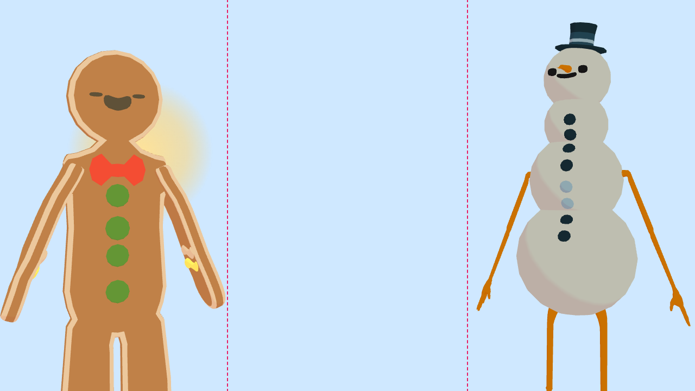
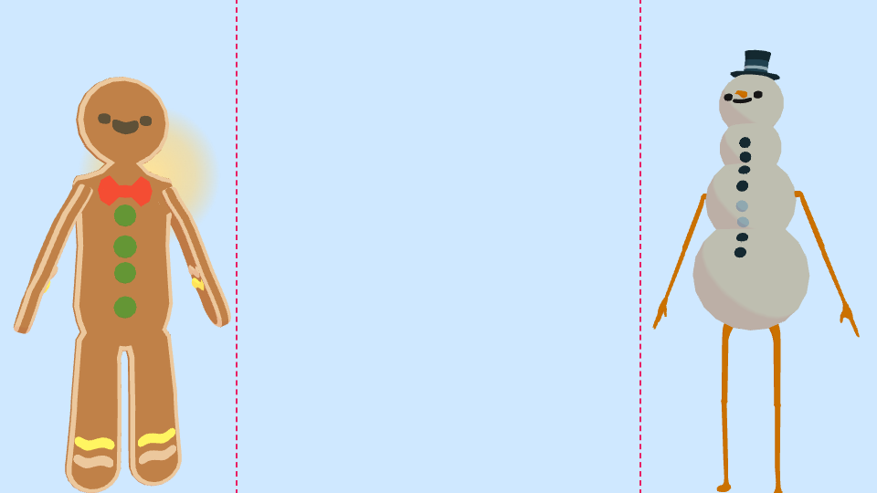
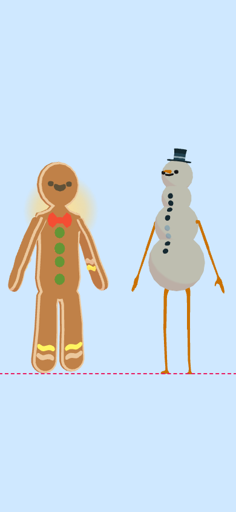

# How to embed the avatar page in a game's page

For a game that frames `/avatar` in an `<iframe>` so its players have faces and voices (first user: Wavelength, VIK-E6). The hub and the avatar page keep the voice, faces and audio; the game page draws nothing of the avatars and plays no sound itself. A game server drives the hub with `vikaki-client`, one driver per seat ([ADR-0017](adr/0017-one-driver-per-seat.md)); the browser never talks to the hub except through this page.

Each section below says which card added it. Pin to the commit named on that card.

## The URL

```html
<iframe src="http://127.0.0.1:8787/avatar?seats=2&embed=1&hud=0" allow="autoplay"
        style="border:0;width:100%;height:100%"></iframe>
```

| Parameter | What it does |
| --- | --- |
| `seats=N` or `seats=north:ada,south:ben` | The table page: one avatar per seat ([personas.md](personas.md)). Without it, the page shows one avatar, `persona=` picks which. |
| `embed=1` | Avatars only (VIK-64). See below. |
| `bg=00b140` | A solid background, six hex digits. Without it the background is transparent. |
| `layout=duet` | Two seats facing each other round a clear central band (VIK-68). See below. |
| `parent=<origin>` | The origin of the page that frames this one, such as `http://127.0.0.1:8765`: a bare `http(s)` origin, no path, never `*`. Turns on the messages in "Sound" below. Without it the page sends and obeys nothing. |
| `names=1`, `captions=1` | In embed mode, bring back the name plates under the avatars and the transcript strip. Off by default. |
| `hud=1` | In embed mode, show the small status line in the corner. Off by default (it is on outside embed mode). |

## `embed=1`

Draws the avatars and nothing else: no pot or board strip, no name plates, no transcript, no status line, no side panel, dock or controls. The background is transparent, so the host page shows through; `&bg=` paints a solid colour instead.

Things to know:

- The page drops its own `color-scheme`. A framed document is only see-through when its colour scheme matches the page around it; with `light dark` a dark-mode visitor on a light page would get a grey box.
- The canvas fills the frame and is sized by the stylesheet, so size the iframe, not the canvas.
- Without `embed=1` nothing changes.

## `layout=duet`

For a two-player game that draws its own board between the players. Needs `seats=2` (any other number is an error on the page). Works with `embed=1`.

- **Wide canvas (772 px or more):** the left seat on the left, the right seat on the right, each turned about 30 degrees toward the other, and a **band 440 px wide, centred, full height** with nothing of the avatars in it. Draw your dial there. The avatars hug the band and are as big as the height and the room beside the band allow.
- **Narrow canvas (under 772 px, a phone):** the avatars stand side by side above a **full-width band** at the bottom, as tall as a half-circle dial (half the width plus 32 px, at most 60% of the canvas height). The avatars are cut off at the band's top edge.
- **The speaker is marked:** the avatar whose line is heard is at full brightness with a warm halo behind the head; the other is dimmed to about 60%, and glances toward the speaker. While someone is thinking (`turn_started`) the same marks follow the thinker. With nobody speaking both are normal. The halo and the dimming ease in and out over about a quarter of a second.
- Size the iframe to the canvas you want; the page measures itself, so the band is always centred in the frame (or at its bottom).
- `names=1` puts the name plates along the bottom of the frame, which in duet is inside the band: leave it off and draw names yourself.

A test samples the band while a seat speaks and fails on any pixel of the page in it, at 1280x720, 960x540 and 390x844 (`packages/e2e/test/embed.e2e.test.ts`).

| Desktop 1280x720 | Small laptop 960x540 | Phone 390x844 |
| --- | --- | --- |
|  |  |  |

(The dashed outline marks the band and is drawn by the screenshot script, not by the page. The seat on the left is speaking.)

## Sound: `audio_locked` and `unlock`

A browser keeps the avatar page silent until the person has clicked on it, and a click on your page does not count: it is another origin. So the first lines would be mute. In embed mode the page tells you, and you can unlock it from your own click. ([ADR-0020](adr/0020-audio-unlock-handshake-for-embedded-pages.md) has the evidence.)

```html
<iframe id="avatar" allow="autoplay"
        src="http://127.0.0.1:8787/avatar?seats=2&embed=1&layout=duet&hud=0&parent=http%3A%2F%2F127.0.0.1%3A8765"></iframe>
<button id="start">Start</button>

<script>
  const frame = document.getElementById("avatar");
  const HUB = "http://127.0.0.1:8787"; // the origin of the hub that serves the page
  addEventListener("message", (e) => {
    if (e.origin !== HUB || e.source !== frame.contentWindow) return; // ignore everyone else
    if (e.data.type === "audio_locked") showStartButton();
    if (e.data.type === "audio_unlocked") hideStartButton();
  });
  document.getElementById("start").addEventListener("click", () => {
    frame.contentWindow.postMessage({ type: "unlock" }, HUB); // from the click handler, to the hub's origin, never "*"
  });
</script>
```

| Direction | Message | Meaning |
| --- | --- | --- |
| page to host | `{ "type": "audio_locked" }` | The browser is blocking sound. Sent once the page knows, and again if it becomes locked. |
| page to host | `{ "type": "audio_unlocked" }` | Sound is allowed now. |
| host to page | `{ "type": "unlock" }` | Send it from a click handler on your page. The page resumes its audio. |
| host to page | `{ "type": "audio_status" }` | Ask the page to say again which of the two it is (if your listener started after the frame loaded). |

Rules, all of them tested:

- **`allow="autoplay"` on the iframe is required.** Without it the browser refuses, and neither your click nor `unlock` changes anything.
- **`?parent=` must be your page's origin.** The page posts only to that origin and accepts only messages whose `source` is the parent window and whose `origin` is that one. With no `?parent=` (or a wrong one) it posts nothing and ignores `unlock`.
- **Send `unlock` from your click handler.** A click on your page alone does nothing: the page has to be told.
- **A small "Click for sound" button** shows in the frame's top-left corner while the browser blocks sound. A click on it always works, with or without the handshake. Keep the frame visible and clickable (no overlay on top of it) so that this way out stays open.
- A line spoken while locked is **silent, not delayed**: it is shown (its mouth moves) and gone. Show your "start" button before the first line.
- The page also writes a note to the browser console when it finds sound blocked, saying what to do.

Tested in Chromium. Firefox and Safari were not tested: check your target browser once by hand (open your page, do not touch the frame, press your start button, speak a line). If `unlock` does not work there, the in-frame button is the fallback.
