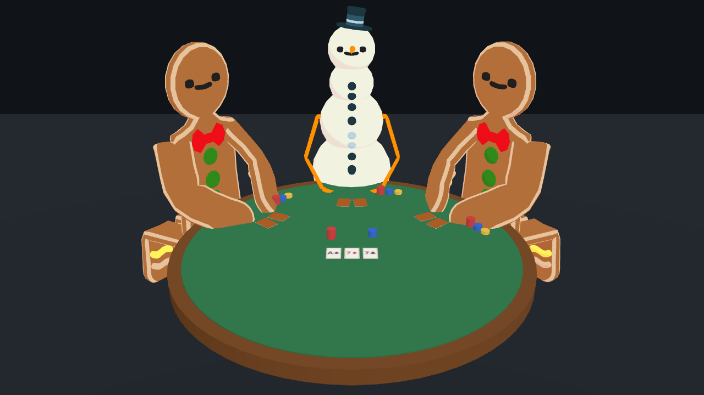
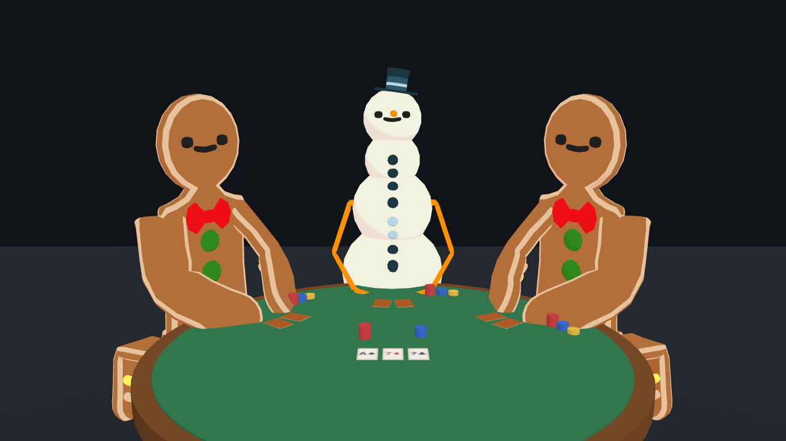
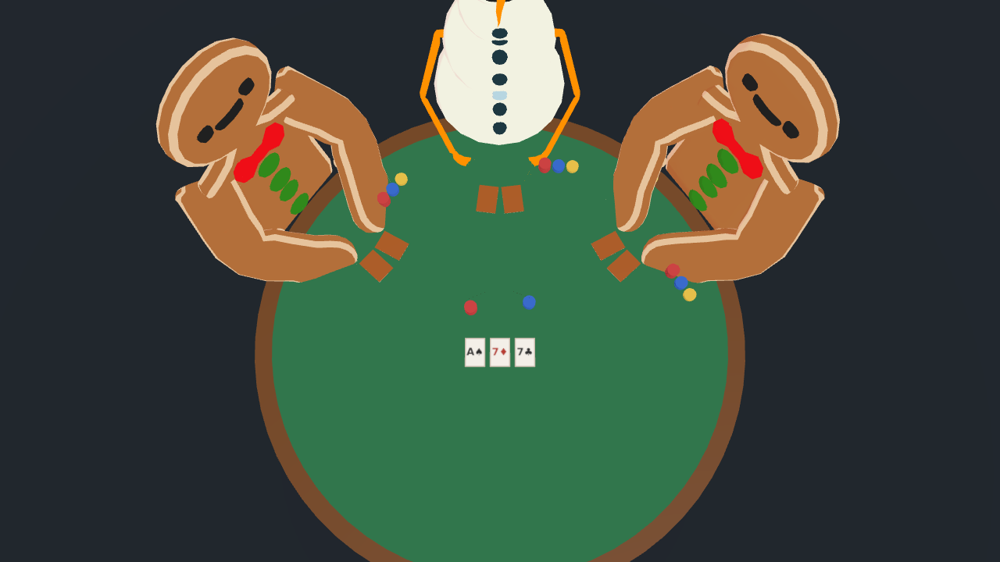
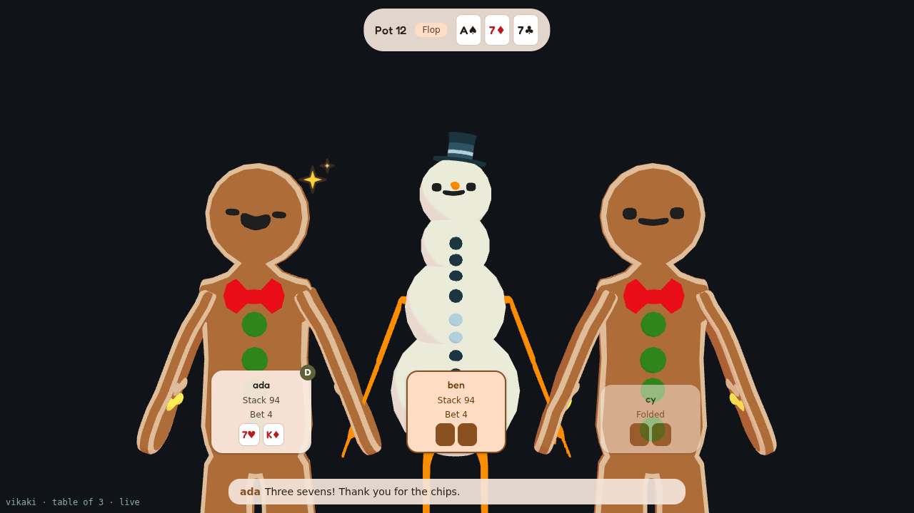

# 3D table presence spike (VIK-60)

Date: 2026-10-16. Harness: `spikes/table3d/` (throwaway). Pictures: `docs/spikes/table3d/`. Part of [ADR-0018](../adr/0018-a-live-poker-table-with-llm-seats.md).

**Question.** Today the table is a row of three busts facing the camera (`?seats=3`, see `row-today.png`). Would seated avatars with hands on a table, with cards and chips, be worth building, and what would it ask of the renderer?

**Answer.** Worth building as a second view, not a replacement, and not yet. It works with the two bundled avatars and costs little to draw, but it needs a seated pose the renderer cannot express today, and every avatar needs its own pose numbers. The row stays the default (it is also what a meeting or an MJPEG feed wants: big faces). Follow-up card suggested at the end.

## What was built

One page, no changes to the engine: three avatars (Cookieman, Snowy, Cookieman) on a half circle across a round table, each turned to face the middle. Plain meshes for everything else: a felt top and rim, a pedestal, two face-down cards in front of each seat, a stack of three chip colours per seat, chips and three face-up cards (canvas textures, `A♠ 7♦ 7♣`) in the middle, a dealer button. Cameras tried: `high` (above the table, three-quarter), `low` (closer, near eye level), `top` (straight down).

| `high` | `low` | `top` |
| --- | --- | --- |
|  |  |  |

The row today, for comparison, with the VIK-59 overlay: 

## What it showed

- **It reads as a card table at once.** The hands on the felt, the cards and the chips say "poker" with no label. The row needs the overlay for that. This is the main gain.
- **Faces stay readable if the camera is low.** Head width on a 1280 px canvas: about 140 px in the row, 135 px in `low`, 110 px in `high`. `top` loses the faces and is only good for the cards and chips. Use `low`, or `high` with fewer seats.
- **The table height comes from the hands, not from a number.** A fixed table height hid the forearms of the seated avatars. Posing first and then setting the table top to where the hands ended up (the middle of the three, so one odd avatar does not decide) fixed it. In the renderer that means asking an avatar where its hands rest, per pose.
- **Seated is two bones each way.** Thighs forward by 90 degrees, shins back, and the hips lowered by 45% of their height. The table hides the rest. Cookieman has the leg bones; Snowy's legs are sticks and stay straight, which the table hides.
- **Arms are per avatar.** Cookieman's arms (forward 1.0 rad, down 1.0 rad, elbow in 0.9 rad) rest on the table. The same numbers on Snowy bend its stick arms into a wide W, with the hands just reaching the table's edge: usable, but it would want its own numbers to look natural. Any avatar added later needs its own numbers too, so they belong in data next to the avatar (the personas file), not in code.
- **Thighs poke out at the sides.** From `high`, the knees of the outer seats show past the rim. A chair or a smaller seat radius would hide them.
- **Hands are mitts.** Cookieman's hands have no fingers, which is fine for a cartoon (ADR-0005), but "picking up cards" would be a slide of the whole hand, not a grip. Not needed: cards could just move.

## Cost

| | draw calls | triangles | render time (software WebGL, 30 frame mean) |
| --- | --- | --- | --- |
| three avatars, no table | 4 | 20 k | 0.9 ms |
| with the table | 102 | 24 k | 2.7 ms |

Nearly all of the extra calls are chips, one mesh per chip. Merging a stack into one instanced mesh brings it to about 10 calls. Triangles barely change. The ratio is what matters here (a software renderer says nothing about a real GPU), and it says the table is cheap once chips are instanced.

## What building it would need

1. **A pose on the renderer.** `SceneAvatar` (`packages/engine/src/renderer.ts`) has `lowerArms()` and `framing()`. A table view needs an optional `seat(pose)`: legs, arms and hip drop for the pose, and a `handHeight()` to place the table. An avatar that cannot (a future 2D or doodle avatar, VIK-32) simply does not offer it, and the page stays on the row. That is a change to the contract, so it gets its own ADR when it is built.
2. **Pose data per avatar** in the personas file (`pose: {arms: ..., hip_drop: ...}`), with the spike's numbers as the default for humanoid VRMs and a way to say "arms hang" for stick-armed ones.
3. **`table_state` drawn in 3D.** Cards from `board` and each seat's `cards` (`back` is the face-down texture), chip stacks from `stack` and `bet`, the dealer button from `dealer`. The page keeps no game logic, as now. The VIK-59 overlay plates move to a projected anchor per seat.
4. **The head turn generalised.** `lookYaw` (VIK-58) assumes a row. On a circle it becomes the angle between a seat's facing and the direction to the speaker, which is simple.
5. **Emotion marks that face the camera.** The manga symbols are placed above each head and assume a row facing the camera; seats turned toward the middle need them billboarded.
6. **A `?view=table` switch** next to `?seats=N`, defaulting to the row.

## Not covered

Real chip counts and card movement (a deal, a bet sliding forward), shadows, seats other than three, a table with a seat nearest the camera (its back would face the viewer), and any avatar beyond the two bundled ones.

## Suggested card

"Table: 3D view (`?seats=N&view=table`)": items 1 to 6, after an ADR for the pose API. Size about 8 points. Not urgent; the row plus the overlay already tells the story of a hand.
